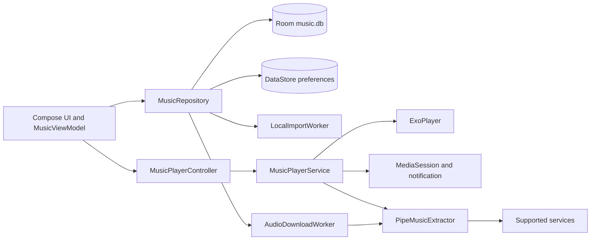

# Architecture

PipeMusic keeps the extraction and download engine of PipePipe and replaces the video-oriented
Android client with an audio-first Jetpack Compose application.

## Module overview

```text
PipeMusicClient          Android application, Compose UI, playback service, Room database
PipeMusicExtractor       Multi-platform extraction engine (Gradle composite build)
ffmpeg                   In-app FFmpeg integration, used when only a muxed stream is available
```

The upstream client code under `org.schabi.newpipe` is retained but no longer hosts the launcher
entry point. The music implementation lives in its own package:

```text
PipeMusicClient/app/src/main/java/org/schabi/newpipe/music/
├── data/        # Room database, DAOs, repository, preferences, locale, account manager
├── local/       # folder scanning, metadata reading, import worker
├── playback/    # queue, player service, controller, UI state
├── stream/      # search, audio stream resolution, download worker
└── ui/          # Compose theme, screens, components, view model
```

## Dependency graph



## Data layer

`MusicDatabase` is a standalone Room database (`music.db`) that is intentionally separate from the
legacy NewPipe database. This avoids migrations against upstream entities at the cost of a small
amount of duplicated metadata.

Entities:

| Entity | Purpose |
| --- | --- |
| `Track` | A song: source metadata, local file path, download state, favourite flag, play count |
| `Playlist` | A user playlist |
| `PlaylistTrack` | Ordered join table between playlists and tracks |
| `PlayHistory` | Recently played entries |
| `SearchHistory` | Recent queries |

`MusicRepository` is the single entry point for library, playlist, favourite, history and download
state queries. `MusicPreferences` stores theme, audio quality, repeat mode, shuffle and the last
queue snapshot in DataStore.

## Playback

- `MusicPlayerService` owns one ExoPlayer instance and one `MediaSessionCompat`. It handles audio
  focus, headset disconnection, the foreground notification, lock-screen controls, media buttons
  and the sleep timer.
- `PlaybackQueue` is pure Kotlin logic holding the track list, current index, shuffle order and
  repeat mode. It is covered by unit tests.
- `MusicPlayerController` binds the service and exposes playback state as `StateFlow`. The
  playback position is throttled to roughly 500 ms so that the root layout does not recompose on
  every frame.
- The queue is persisted; after a service restart the queue is restored in a paused state.

## Search and streaming

`MusicSearchRepository` wraps the extractor search API. It maps only stream items to tracks,
supports pagination, debounces input and cancels the previous request when the service changes.
Pasted links are resolved with the service-by-URL lookup before extraction.

`AudioStreamResolver` selects the highest bitrate audio stream. When a service only offers a muxed
stream, the track is played as audio and, for downloads, the audio track is extracted with FFmpeg.
Expired URLs are re-resolved once, preserving the playback position.

## Downloads and local import

Both are WorkManager foreground workers so they survive leaving the screen:

- `AudioDownloadWorker` re-resolves the URL inside the worker, writes to a temporary file and
  atomically renames it on success. Status and progress are written to the `Track` row, so the UI
  simply observes Room.
- `LocalImportWorker` scans a document tree granted through the storage access framework, copies
  audio files into the private `files/music` directory, extracts metadata and embedded artwork
  with `MediaMetadataRetriever`, de-duplicates by source URI and reports progress, cancellation
  and a failure summary.

All files stay inside the app-private `music` and `artwork` directories, and delete operations
validate canonical paths.

## UI layer

A single `MusicMainActivity` hosts the Compose tree. Navigation uses a sealed route with a back
stack and `BackHandler` instead of Navigation Compose. Screens: Home, Search, Library, Playlists,
Playlist detail and Profile, plus a persistent mini player and a full-screen player overlay.

`MusicTheme` and `ColorSchemeFactory` provide eight preset seed colours, a custom HSV picker,
light/dark/system/AMOLED modes, Android 12+ dynamic colour and optional artwork-based tinting.
Colour schemes are cached per seed and mode.

## Entry point isolation

- The launcher intent filter belongs to `MusicMainActivity`.
- `MainActivity` is not exported and has no launcher category.
- `RouterActivity` intercepts `VIEW` and `SEND` intents, extracts the URL and forwards it to the
  music experience.
- The legacy video player service is never started, so it cannot compete for the media session.

## Logging and privacy

Logs use the tags `MusicPlayer`, `MusicSearch`, `MusicImport` and `MusicDownload`. They record
service IDs, track IDs and error types only. Cookies, signed stream URLs and user file paths are
never logged.
